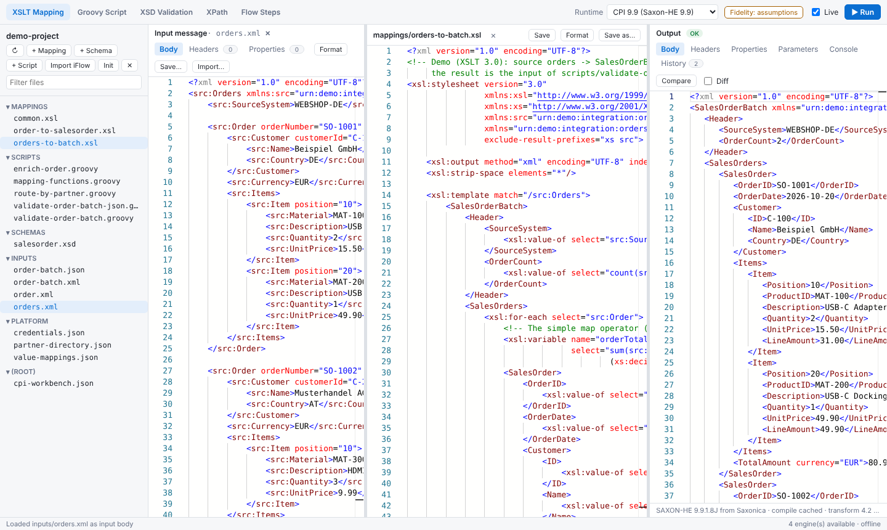

# CPI Workbench

[](https://github.com/jsevenheck/cpi-workbench/actions/workflows/build.yml)
[](https://github.com/jsevenheck/cpi-workbench/releases/latest)
[](LICENSE)

An offline desktop app for testing **SAP Integration Suite (Cloud Integration)** mappings, scripts
and individual flow steps locally. Enter a body, headers and exchange properties, run the step and
inspect its output, diagnostics and logs—without deploying to a tenant.

| Tool | What it runs |
|---|---|
| XSLT Mapping | Saxon-HE **9.9** (CPI's release line, but not its EE edition) or **12**, typed CPI parameter binding, `hci:setHeader` / `hci:setProperty`, project-local includes. |
| Groovy Script | **1.x: Groovy 2.4.21**, **2.x: Groovy 4.0.29**, both on **Camel 3.14.7 / Java 21**, with clean-room Script APIs, MPL, console and local platform mocks. |
| Message Mapping functions | Groovy custom functions with `MappingContext`, per-context arguments and `Output`; not graphical `.mmap` execution. |
| XSD / XPath | XML Schema 1.0 validation, XPath 3.1 or 1.0, highlighted matches and XPath at cursor. |
| Flow Steps | Content Modifier, Filter, Router, General / Iterating Splitter, Gather, JSON ↔ XML / XML ↔ CSV converters, Encoder / Decoder (Base64, GZIP, ZIP) and Message Digest. |

The project workflow includes iFlow-zip import, runtime comparison, Groovy migration hints,
file-based CLI tests and a built-in [MCP server](docs/mcp.md) for coding agents. CPI Helper can hand
traced messages over by pasted links, browser-mode links or an opt-in desktop receiver with confirmation.

Behaviour follows SAP's documentation, published interfaces and Saxon's/Camel's behaviour, with
selected probes checked on one tenant. [Fidelity](docs/fidelity.md) lists the evidence, assumptions
and known limits. This is not a whole-iFlow simulator.

Everything runs locally; the app never connects to a tenant. **Check for updates** contacts GitHub
only when clicked. The optional receiver accepts loopback traffic only. Groovy scripts and XSLT
Java calls are **not sandboxed**: run code you trust ([access rules](docs/user-guide.md#what-a-run-can-access)).



## Install and start

Download a Windows x64 or macOS Apple Silicon installer from the
**[latest release](https://github.com/jsevenheck/cpi-workbench/releases/latest)**. It includes the
engines and Java runtime. Installers are unsigned; [Installing](docs/install.md) explains first-start
warnings, managed-device restrictions and CLI/Linux alternatives.

1. Open a project folder and press **Init**, or open [`examples/demo-project`](examples/demo-project/README.md).
2. Open a mapping or script, enter the input and press **Ctrl+Enter**.

The [user guide](docs/user-guide.md) covers the tabs, CPI Helper, CLI and browser mode.
[Status](docs/status.md) describes the current checkout; the [changelog](CHANGELOG.md) separates
released and Unreleased changes.

### Command line

Release jars need Java 17+ (21 matches the app's runtime). From source:

```sh
mvn -f engine/pom.xml package -DskipTests
java -jar engine/xml-he99/target/cpiwb-xml-he99.jar test testdata/regression-project/tests
java -jar engine/groovy-v1/target/cpiwb-groovy-v1.jar test testdata/regression-project/tests
```

### Coding agents

For Claude Code on Windows, add `.mcp.json` to the project:

```json
{ "mcpServers": { "cpi-workbench": {
    "command": "${LOCALAPPDATA}\\CPI Workbench\\cpi-workbench.exe", "args": ["mcp"] } } }
```

The app window need not be open. Other platforms/clients and server privileges: [MCP setup](docs/mcp.md#setup).

## Documentation and contributing

See the [documentation index](docs/README.md) for guides, [project and platform formats](docs/project-files.md),
[build/release steps](docs/building.md), [architecture](docs/architecture.md) and the
[research ledger/roadmap](docs/plan.md). Issues and pull requests are welcome
([Contributing](CONTRIBUTING.md)); report vulnerabilities privately ([Security](SECURITY.md)).

## Licence

[Apache License 2.0](LICENSE). SAP, SAP Integration Suite and Cloud Integration are trademarks of
SAP SE; this project is not affiliated with or endorsed by SAP. **No SAP code or jars are included**;
`com.sap.*` classes are clean-room implementations of published signatures/documentation.

Bundled components include Saxon-HE (MPL-2.0), Groovy/Camel (Apache-2.0), Tauri/Monaco (MIT/Apache-2.0),
OpenJDK and GraalVM runtimes (GPLv2 with Classpath Exception), JavaBeans Activation (CDDL/GPLv2+CE)
and the MIT-licensed pizug test corpus. Full component versions, licence texts and source locations:
[`licenses/`](licenses/README.md). Installers and engine jars include the notices.
